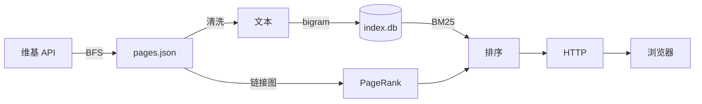

# zhwiki-search

用本地抓取的 500 篇中文维基条目，从零复现搜索引擎的完整链路：抓取 → 清洗 → 分词 → 索引 → 排序 → 服务。纯 Python 标准库实现，倒排索引 + BM25 + PageRank。



```bash
python -m zws crawl --category 搜索引擎 --limit 500   # → data/pages.json
python -m zws index                                    # → data/index.db
python -m zws search "搜索引擎 历史"
python -m zws eval                                     # 标注集指标
python -m zws serve                                    # http://localhost:8000
```

## 实现原理

### 抓取

```
https://zh.wikipedia.org/w/api.php?action=query&format=json
  &prop=extracts|links&explaintext=1&redirects=1&pllimit=500
  &titles=<条目名>
```

`explaintext=1` 去 wiki 标记，不带 `exintro` 取全文，出链同响应返回。每秒一请求，带自定义 `User-Agent`。

### 清洗

| 噪音 | 处理 |
|---|---|
| `== 参见 ==` | 按行首丢弃 |
| 参考文献 / 外部链接 / 参见 | 在此截断 |
| `（英語：search engine）` | 整段去除 |

### 分词

中文无空格，词典分词会引入依赖。滑窗切**汉字二元组**，去标点与数字。

### 倒排索引

```sql
CREATE TABLE docs    (id INTEGER PRIMARY KEY, title TEXT, url TEXT, length INTEGER);
CREATE TABLE postings(term TEXT, doc_id INTEGER, tf INTEGER);
CREATE INDEX idx_term ON postings(term);
```

### 排序

```
BM25:  score(D,Q) = Σ IDF(q) · f(q,D)·(k₁+1) / ( f(q,D) + k₁·(1−b+b·|D|/avgdl) )
       IDF(q)     = ln(1 + (N−n(q)+0.5) / (n(q)+0.5))
       k₁ = 1.5, b = 0.75

PageRank: d = 0.85, 20 轮, 悬空节点均分

融合:  final(D) = bm25(D) · (1 + α · pr_norm(D))
```

`α` 记在 `config.json`。

### 服务

单文件 `http.server`：搜索框、高亮片段、分页。无模板引擎、无前端框架。

## 设计取舍

| 决策 | 备选 | 理由 |
|---|---|---|
| 汉字二元组 | jieba | 全链路零依赖；召回优先，该语料规模够用 |
| SQLite | JSON | posting 超百万行，避免索引常驻内存 |
| BM25 | TF-IDF | 词频饱和 + 文档长度归一 |
| PageRank 融合 | 单用 PageRank | 文本相关性与链接权威度是不同维度 |
| 标准库 | Flask/requests/numpy | 强制显式写 HTTP、SQL、解析 |

## 评测

| 指标 | 值 |
|---|---|
| 条目数 | 待填 |
| 总字数 | 待填 |
| 词表（唯一二元组） | 待填 |
| posting | 待填 |
| 索引体积 | 待填 |
| 延迟 p50 / p95 | 待填 |
| top-3 命中率（20 条标注） | 待填 |

`eval/queries.json`：查询 + 人工判定相关条目。

## 局限

- 500 篇子集，非完整维基，召回率不可与生产系统比较
- 二元组精度有限，词典分词可提升但要引入依赖
- 单进程，受每秒一请求限速约束
- 无增量索引，新增条目需全量重建

## 路线

**一期**

- [ ] 抓取 500 篇全文 + 出链
- [ ] bigram 倒排入 SQLite
- [ ] BM25 排序
- [ ] PageRank 融合
- [ ] Web 界面
- [ ] 20 条标注集 + 指标回填

**二期**

- [ ] embedding 向量 + 磁盘缓存
- [ ] 暴力余弦检索
- [ ] RRF 融合，对比单路 / 双路命中率
- [ ] SQLite FTS5 基线对比

## 环境

Python 3.11+，无第三方包。

## 数据与许可

正文取自中文维基百科 API，遵循 [CC BY-SA 4.0](https://creativecommons.org/licenses/by-sa/4.0/)；请求带描述性 `User-Agent`，限速每秒一次，内容仅本地索引。代码 MIT。
